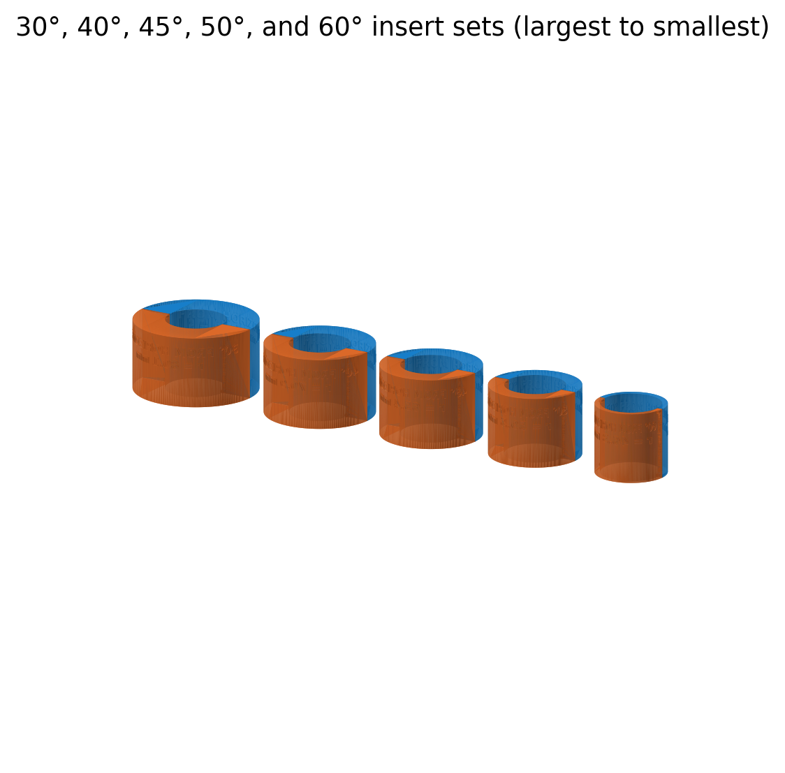

# Physics demonstrations

This repository collects reproducible classroom physics demonstrations, including printable hardware, source models, measured reference geometry, assembly instructions, and validation artifacts. Each demonstration lives in its own folder so that finished STLs and the scripts used to generate them stay together.

## Demonstrations

### [Torque and spool-paradox demonstration](torque-spool-demo/)

A configurable spool-paradox kit for demonstrating how the direction of rolling depends on the relationship between the rolling radius, winding radius, and pull angle.

The project currently includes:

- Five two-piece winding inserts labeled for 30°, 40°, 45°, 50°, and 60° critical pull angles.
- Separate A/B STL halves with snug tapered push-fit plugs and no snap latches.
- Large recessed labels on both the mating edges and curved outer surfaces.
- Recessed rope-anchor posts and anti-rotation features matched to the supplied spool.
- Low-profile rope hooks with raised eyelets for the 6.2 mm and 4.0 mm anchor posts.
- The original spool, TPU tire, OpenSCAD source, preview, and assembly instructions.
- Parametric Python generators, inspection renders, dimensional measurements, and automated mesh/fit validation.

## Repository conventions

- Dimensions are millimetres unless a project says otherwise.
- Generated STLs are committed alongside their source so an instructor can print without installing CAD dependencies.
- Validation reports document geometric checks but do not replace a physical test print.
- Each demonstration has its own README with physics, printing, assembly, and regeneration notes.

## Safety

These designs are educational apparatus, not safety-rated hardware. Inspect printed parts before use, keep the demonstration area clear, and do not use the rope hooks or printed components for lifting, climbing, restraint, or other load-bearing applications.
